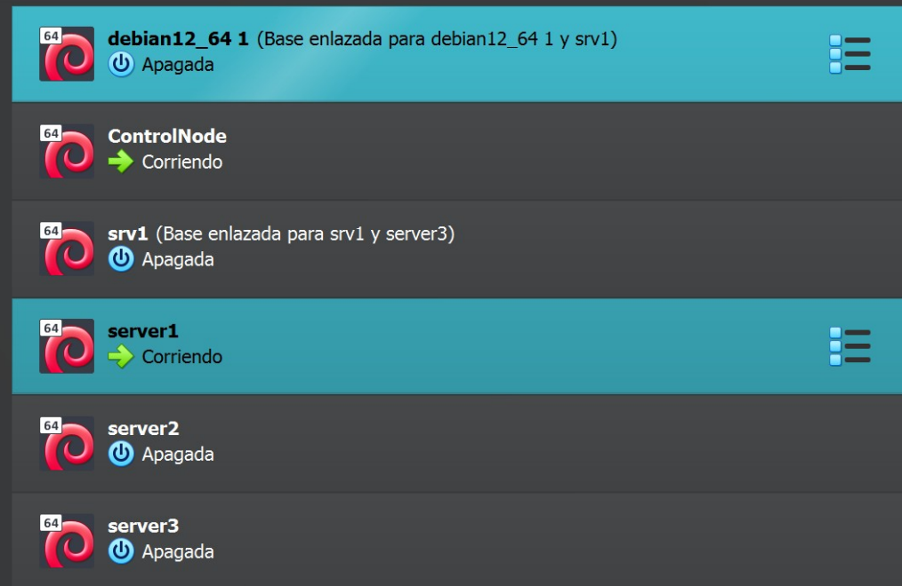

# Ansible
## 1. Introdución
### Que é Ansible?
Ansible é unha ferramenta de automatización sen axentes, usada para:

- Configurar sistemas.

- Despregue de aplicacións.

- Xestión de infraestruturas.

- Orquestración de tarefas complexas.

Está baseada en SSH, usa ficheiros YAML e destaca por ser sinxela, declarativa e idempotente (as tarefas poden repetirse sen efectos secundarios).

### Elementos básicos
| Elemento       | Descrición |
| --- | --- |
| Inventario     | Lista de hosts que Ansible pode xestionar. |
| Playbook       | Conxunto de tarefas descritas en YAML que se aplican a un ou varios hosts. |
| Task           | Cada acción individual (ex: instalar paquete, copiar ficheiro). |
| Role           | Conxunto estruturado de tarefas, templates, handlers, variables, etc. |
| Module         | Comando específico de Ansible (ex: `apt`, `yum`, `copy`, `user`, etc.). |
| Handler        | Acción que se executa se unha tarefa cambia algo (ex: reiniciar un servizo). |
| Facts          | Información recollida automaticamente dos hosts (IP, SO, memoria, etc.). |

### Exemplo de inventario
```ini

[web]

192.168.1.10

192.168.1.11

[db]

192.168.1.12 ansible_user=root

```

### Exemplo sinxelo de playbook
```yaml

---

- name: Instalar Apache en servidores web

  hosts: web

  become: true

  tasks:

    - name: Instalar apache

      apt:

        name: apache2

        state: present

        update_cache: yes

    - name: Asegurar que apache está iniciado

      service:

        name: apache2

        state: started

        enabled: true

```

### Comandos básicos
```bash

# Verificar conexión aos hosts

ansible all -m ping

# Executar unha tarefa ad-hoc

ansible web -m apt -a "name=htop state=present" --become

# Executar un playbook

ansible-playbook site.yml

# Usar inventario personalizado

ansible-playbook -i inventario.ini site.yml

```

### Módulos comúns
| Módulo     | Uso                       |
| --- | --- |
| ping       | Proba de conexión.         |
| copy       | Copiar ficheiros.         |
| template   | Copiar con Jinja2.         |
| apt / yum  | Xestores de paquetes.      |
| service    | Xestionar servizos.        |
| user       | Crear/eliminar usuarios.   |
| file       | Permisos, enlaces, etc.    |

### Boas prácticas
- Usar roles para organizar tarefas complexas.

- Separar variables en `vars/` ou `group_vars/`.

- Evitar duplicación usando `with_items` ou `loops`.

- Manter handlers para accións condicionais como reinicios.

## 2. Escenario de prácticas
Para o seguimento deste material farase uso do ****hipervisor VirtualBox****, onde teremos diferentes máquinas virtuais.

Estas máquinas virtuais terán dous adaptadores de rede:  

- ****Rede interna****: para conectividade entre elas  

- ****NAT****: para acceso ao exterior  

Ademais, as máquinas contarán con ****asignación de enderezos IP por DHCP****.

Para iso, podemos configurar un servidor dhcp para a rede interna de virtualbox:

```powershell

& "C:\Program files\oracle\virtualbox\VBoxManage.exe" dhcpserver add --netname intnet --ip 192.168.1.1 --netmask 255.255.255.0 --lowerip 192.168.1.2 --upperip 192.168.1.254 --enable

```

En cada máquina virtual (podemos facelo sobre a plantilla xa) temos que configurar o `/etc/network/interfaces`:

```bash

auto enp0s8

iface enp0s8 inet dhcp

```

Será necesario, para realizar conexións por SSH, establecer un ****mapeo do porto interno 22**** de cada máquina ao ****porto externo**** que o usuario decida utilizar para se conectar por CLI.

### Notas
****Nota 1:**** Os enderezos IP poden variar segundo o usuario que siga o material.  

Antes de copiar claves SSH ou configurar o inventario, comprobar o enderezo IP da interface de rede interna en cada servidor con `ip -br addr`. Substituír os enderezos dos exemplos polos reais das máquinas; non empregar o enderezo do adaptador NAT para a comunicación entre elas.

****Nota 2:**** Recoméndase ****non apagar**** as máquinas, senón ****gardar o seu estado**** para retomar facilmente a práctica.  

****Nota 3:**** Pode darse o caso de que algunhas máquinas ****perdan a hora actual****, o que pode impedir realizar instalacións ou outras tarefas.

Podemos comprobalo e solucionalo:

```bash

usuario\@debian:\~$ date

lun 03 nov 2025 10:14:25 CET

usuario\@debian:\~$ sudo date -s "2025-11-03 10:30:00"

lun 03 nov 2025 10:30:00 CET

usuario\@debian:\~$ date

lun 03 nov 2025 10:30:07 CET

usuario\@debian:\~$ sudo date -s "11/03/2025 10:15"

lun 03 nov 2025 10:15:00 CET

usuario\@debian:\~$ date

lun 03 nov 2025 10:15:01 CET

```

### Instalación de Debian 13 en VirtualBox
A imaxe ISO de Debian 13 pódese descargar aquí:  

[Descargar ISO Debian 13](https\://cdimage.debian.org/debian-cd/current/amd64/iso-cd/debian-13.2.0-amd64-netinst.iso)

### Configuración da máquina virtual
- ****Memoria base:**** 4096 MB  

- ****Procesadores:**** 4  

- ****Almacenamento:**** 50 GB  

- ****Usuario:**** `usuario` (contrasinal: `usuario`)  

- ****Root:**** contrasinal: `\<espazo>` (barra espazadora)  

#### Rede  
Configuraranse na plantilla os seguintes adaptadores:

- Adaptador 1 → Avanzado → Reenvío de portos:

  - **Porto anfitrión:** 2222 (Por exemplo. Hai que cambialo en cada clonación).  

  - **Porto convidado:** 22  

- Adaptador 2 → rede interna → intnet

### Creación do usuario *ansible* na máquina inicial
Antes de clonar, creamos o usuario `ansible` na máquina inicial. Así estará dispoñible tanto no nodo controlador como na plantilla dos nodos xestionados.

Como `root`, instalamos a ferramenta `whois` para xerar o hash do contrasinal e creamos o usuario:

```bash
apt install -y whois
useradd -m -d /home/ansible -p "$(mkpasswd 'ansible')" -s /bin/bash ansible
grep ansible /etc/passwd
```

### Máquinas necesarias en VirtualBox
En VirtualBox teremos unha máquina inicial e realizaremos ****dúas clonacións enlazadas****:

- ****AMN:**** **Ansible Management Node**  

- ****srv_template:**** actúa como plantilla para os nodos xestionados  

### Instalación do servidor SSH
Tras finalizar a instalación de Debian 13, abrir unha terminal e executar:

```bash

apt update

apt install openssh-server -y

```

Con isto, xa podemos conectarnos dende o anfitrión:

```bash

ssh -p 2222 usuario\@localhost

```

### Contorno en VirtualBox
A continuación móstrase un posible grupo de máquinas en VirtualBox para o seguimento do material.



## 3. Instalación de Ansible
Unha vez creadas as máquinas de ****nodo controlador**** e ****plantilla**** para os servidores coa súa correspondente IP, procedemos coa instalación manual de ****Ansible****.

En primeiro lugar é recomendable cambiar o nome do host:

```bash

hostnamectl set-hostname ControlNode

```

Despois disto é recomendable reiniciar.

Para instalar Ansible é necesario dispoñer previamente de ****Python****, xa que este é o motor sobre o que se executa a ferramenta.  

Ansible está desenvolvida principalmente en Python, polo que depende del tanto para o seu funcionamento básico como para a execución dos seus módulos.

```bash

usuario\@ControlNode:\~$ python3 --version

Python 3.13.5

```

### Instalación de Ansible mediante pipx

En Debian 13 utilizaremos `pipx`, que instala aplicacións Python en contornos illados e evita a opción `--break-system-packages`.

Como `root` no nodo controlador, instalamos `pipx`:

```bash
apt update
apt install -y pipx
```

Como usuario `ansible` do nodo controlador, executamos:

```bash
pipx ensurepath
pipx install --include-deps ansible
```

A opción `--include-deps` expón tamén os executables de `ansible-core`. Se `pipx ensurepath` modificou o `PATH`, abrir unha nova sesión como `ansible` antes de verificar a instalación.

### Verificación

```bash
ansible --version
ansible-playbook --version
```

Versión comprobada: **Ansible 15.0.0**, **ansible-core 2.22.0** e **Python 3.13.5**.

### Documentación e `ansible-doc`
A documentación ofical de ansible está dispoñible nesta [ligazón](https\://docs.ansible.com).

Outra forma de consultar a documentación e mediante o comando `ansible-doc`. Así, por exemplo, podemos consultar a documentación sobre un `módulo` (elemento mínimo de ansible destinado a unha tarefa determinada) concreto:

```bash

ansible\@ControlNode:\~$ ansible-doc -l

...

ansible\@ControlNode:\~$ ansible-doc -s ping

```

## 4. Configuración dos nodos xestionados
A continuación explícase o proceso de configuración dos nodos que serán administrados desde o ****nodo controlador**** onde se instalou Ansible. Para a xestión destes nodos necesitamos seguir os seguintes pasos:

### Proceso a seguir
#### Paso 1: Python instalado
No noso caso, a máquina xa conta co intérprete de Python instalado:

```bash

usuario\@srvTemplate:\~$ python3 --version

Python 3.13.5

```

#### Paso 2: Ter un servidor SSH
A máquina tamén conta cun servidor SSH instalado. Se non estivera presente, sería necesaria a súa instalación:

```bash

apt update

apt install openssh-server -y

```

#### Paso 3: Dispoñer do usuario ansible
O usuario `ansible` xa foi creado na máquina inicial antes das clonacións. Máis abaixo configuraremos os seus permisos de administración mediante sudo.

#### Paso 4: Copiar claves SSH dende o ControlNode
Debemos copiar a clave pública SSH do usuario do ****ControlNode**** ao usuario desexado nos nodos xestionados.

#### Paso 5: Configuración de sudo en caso de usar un usuario `ansible`
Será necesario configurar `/etc/sudoers` para o usuario xa creado.

---

### Instalación de Python (nos nodos xestionados)
```bash

usuario\@srvTemplate:\~$ python3 --version

Python 3.13.5

```

---

### Servidor SSH
Se é necesario instalar o servidor SSH:

```bash

apt update

apt install openssh-server -y

```

---

**Importante:** A clave SSH do usuario do nodo controlador debe xerarse despois de clonar as máquinas, non na plantilla. Ao clonar, asignar novos enderezos MAC e verificar que cada equipo dispón de identidade de máquina e claves SSH de servidor propias.

### Creación do par de claves SSH
Dende `AMN`:

```bash

ansible\@ControlNode:\~$ ssh-keygen -t ed25519

ansible\@ControlNode:\~$ ls .ssh/

id_ed25519  id_ed25519.pub

ansible\@ControlNode:\~$ ssh-copy-id -i .ssh/id_ed25519.pub ansible\@192.168.122.5

```

Verificación en `srvTemplate`:

```bash

ansible\@srvTemplate:\~$ ls .ssh/

authorized_keys

ansible\@srvTemplate:\~$ cat .ssh/authorized_keys

ssh-ed25519 AAAAC3...

```

Probamos conexión:

```bash

ansible\@ControlNode:\~$ ssh 192.168.122.5

```

Nota: Isto só funciona co usuario **ansible**. Outros usuarios seguirán requirindo contrasinal.

---

### Instalación de sudo
```bash

root\@srvTemplate:\~# apt update && apt install -y sudo

```

Editar `/etc/sudoers` con ****visudo****:

```bash

root\@srvTemplate:\~# visudo

ansible ALL=(ALL:ALL) NOPASSWD:ALL

```

---

**Nota de seguridade:** `NOPASSWD:ALL` concédelle ao usuario `ansible` permisos administrativos sen contrasinal. Mantense unicamente para simplificar o laboratorio; ao final revisarase esta configuración.

### Comprobación da conexión
Chegados a este punto é recomendable configurar dende o host ssh e VS Code para traballar na máquina `AMN` co usuario `ansible`. Pódese seguir a [guía de uso de vscode e ssh](00.guia_ssh.md)

Creamos unha máquina **srv1** a partir da plantilla e definimos un ficheiro `hosts`:

```bash

srv1 ansible_host=192.168.10.6 ansible_user=ansible ansible_become=yes

```

Probamos o módulo **ping**:

```bash

ansible\@ControlNode:\~/practicas/pr01$ ansible -i hosts srv1 -m ping

srv1 | SUCCESS => {

 "ping": "pong"

}

```

---

### Execución dun playbook de proba
```yaml

---

- name: Playbook inicial

  hosts: srv1

  tasks:

    - name: Instalar os paquetes zip e unzip

      ansible.builtin.apt:

        name:

          - zip

          - unzip

        state: present

    - name: Crear un ficheiro /home/usuario/ejemplo con permisos 644

      ansible.builtin.file:

        path: /home/usuario/ejemplo

        state: touch

        owner: root

        group: root

        mode: "0644"

    - name: Engadir a cadea 'hola' ao ficheiro

      ansible.builtin.shell: |

        if test "$(tail -1 /home/usuario/ejemplo)" != "hola"

        then

          echo "hola" >> /home/usuario/ejemplo

        fi

```

Execución:

```bash

ansible-playbook -i hosts playbook.yaml

```

Resultado:

```bash

PLAY RECAP

srv1 : ok=5 changed=4 unreachable=0 failed=0

```

Comprobación en `srv1`:

```bash

ansible\@srv1:\~$ sudo ls /home/usuario/ejemplo

ansible\@srv1:\~$ sudo cat /home/usuario/ejemplo

hola

ansible\@srv1:\~$ sudo ls -l /home/usuario/ejemplo

-rw-r--r-- 1 root root 5 nov 4 09:21 /home/usuario/ejemplo

```

## 5. O comando `ansible`:
### Estrutura de directorios e inventario
Antes de executar comandos ad-hoc con Ansible, recoméndase crear un directorio de traballo e un ficheiro de inventario:

```bash

mkdir -p practicas/pr01

cd practicas/pr01

touch hosts

```

Exemplo dun ficheiro ****hosts****:

```ini

[servers]

srv1 ansible_host=192.168.10.6 ansible_user=ansible ansible_become=yes

srv2 ansible_host=192.168.10.5 ansible_user=ansible ansible_become=yes

```

---

### Sintaxe básica do comando `ansible`
Todos os comandos ad-hoc seguen esta estrutura:

```bash

ansible -i INVENTARIO DESTINO -m MÓDULO -a "ARGUMENTOS" [-b]

```

- ****INVENTARIO**** → Ficheiro co listado de máquinas.

- ****DESTINO**** → Máquina ou grupo do inventario.

- ****MÓDULO**** → Ferramenta que executa a acción (ping, copy, apt…).

- ****ARGUMENTOS**** → Parámetros do módulo.

- ****-b / --become**** → Escalada de privilexios (sudo).

---

### Exemplo 1: Probar conexión co módulo `ping`
```bash

ansible -i hosts srv1 -m ping

```

Saída esperada:

```json

srv1 | SUCCESS => {

  "changed": false,

  "ping": "pong"

}

```

---

### Exemplo 2: Copiar un ficheiro remoto co módulo `copy`
```bash

echo "Ficheiro de exemplo" > /tmp/meu_ficheiro.txt

ansible -i hosts srv1 -m copy -a "src=/tmp/meu_ficheiro.txt dest=/tmp/copia.txt mode=0644"

```

---

### Exemplo 3: Instalar paquetes co módulo `apt`
```bash

ansible -i hosts srv1 -m apt -a "name=apache2 state=present update_cache=yes" -b

```

Este comando:

- Actualiza a caché de paquetes de APT.

- Instala **apache2**.

- Emprega sudo grazas ao parámetro `-b`.

---

### Comprobación da idempotencia

O exemplo anterior xa actualiza a caché de APT. Se non se executou, actualizar primeiro a caché no servidor con `sudo apt update`.

Executar dúas veces o comando de instalación de Apache2, sen `update_cache` para que a actualización da caché non interfira na comprobación da idempotencia:

```bash
ansible -i hosts srv1 -m apt -a "name=apache2 state=present" -b
```

Na primeira execución, se é necesario instalar o paquete, aparecerá `CHANGED` e `"changed": true`. Na segunda, se o estado xa é o solicitado, aparecerá `SUCCESS` e `"changed": false`. Isto exemplifica a **idempotencia**: repetir unha tarefa non produce cambios innecesarios.

Pode aparecer un aviso sobre o intérprete Python descuberto (`/usr/bin/python3.13`); é informativo e non significa que a instalación fallase.

---

## 6. Ficheiro de configuración e inventario en Ansible 
### 1. Ficheiro de configuración (`ansible.cfg`)

O ficheiro **`ansible.cfg`** define o comportamento de Ansible. A orde de busca é:

1. Variable de contorno `ANSIBLE_CONFIG`.
2. `ansible.cfg` no directorio actual.
3. `~/.ansible.cfg` no directorio persoal do usuario.
4. `/etc/ansible/ansible.cfg`.

Ansible utiliza o primeiro ficheiro válido que atopa. Non é obrigatorio crear un ficheiro de configuración, pois existen valores predeterminados.

Para o laboratorio, creamos directamente un ficheiro mínimo:

```bash
nano ansible.cfg
```

```ini
[defaults]
inventory = ./hosts
forks = 5

[privilege_escalation]
become = True
become_method = sudo
become_user = root
```

- `inventory`: inventario predeterminado, evitando repetir `-i hosts`.
- `forks`: número máximo de equipos xestionados en paralelo.
- `become`: activa a elevación de privilexios por defecto.
- `become_method`: mecanismo de elevación, neste caso `sudo`.
- `become_user`: usuario ao que se elevan os privilexios (`root`), distinto do usuario SSH (`ansible`).

Esta elevación automática é unha simplificación inicial do laboratorio e modificarase na actividade final de seguridade.

Para comprobar o ficheiro de configuración utilizado:

```bash
ansible --version
ansible-config dump --only-changed
```

O comando seguinte tamén permite xerar unha configuración completa de referencia:

```bash
ansible-config init --disabled > ansible.cfg
```

Neste caso, a maioría das opcións aparecen comentadas con `;` e non se aplican explicitamente. Para as prácticas non é necesario xerar ese ficheiro extenso.

### 2. Inventario en Ansible

O inventario define os nodos que Ansible administra. Pode escribirse en formato **INI** ou **YAML**. Os nomes `srv1` e `srv2` son alias de Ansible: non teñen que coincidir co hostname real.

#### Exemplo INI:

```ini
[servidores]
srv1 ansible_host=192.168.10.6 ansible_user=ansible
srv2 ansible_host=192.168.10.7 ansible_user=ansible
```

#### Exemplo YAML:

```yaml
all:
  children:
    servidores:
      hosts:
        srv1:
          ansible_host: 192.168.10.6
          ansible_user: ansible
        srv2:
          ansible_host: 192.168.10.7
          ansible_user: ansible
```

`ansible_host` identifica o enderezo de conexión; `ansible_user`, o usuario SSH. Os enderezos deben adaptarse aos da rede do laboratorio.

O ficheiro `ansible.cfg` establece `inventory = ./hosts`, polo que xa non é necesario indicar o inventario en cada comando:

```bash
ansible srv1 -m ping
ansible servidores -m ping
ansible-inventory --graph
ansible-playbook playbook.yaml
```

Se non se cargou ese ficheiro de configuración, será necesario empregar `-i hosts`. Un aviso como `No inventory was parsed` indica que Ansible non atopou un inventario válido.

### 3. Grupos, subgrupos e rangos
- Pódense definir grupos (`[web]`, `[bd]`).

- Grupos dentro doutros grupos:

```ini

[servers:children]

debian

```

- Rangos de hosts:

```ini

tomcat[1:20]

datos[1:4].empresa.com

```

Grupos especiais:

- ****all**** → todos os hosts  

- ****ungrouped**** → hosts non asignados

Pódese usar máis dun inventario:

```bash

ansible -i inventario1 -i inventario2

```

---

### 4. YAML en poucas palabras
YAML é un formato sinxelo, baseado en sangrías e moi usado en automatización.

Normas principais:

- Sangría con espazos (non tabulacións)

- Clave: valor

- Listas con `-`

- Estrutura xerárquica clara

## 7. Introdución aos Playbooks
Un **playbook** é unha especie de plantilla que nos permite executar contornos complexos dentro de Ansible sen necesidade de intervención humana. Deste modo pódense automatizar múltiples procesos de maneira moi sinxela. Utilízanse ficheiros en formato ****YAML****, polo que é fundamental coñecer a súa estrutura e sintaxe.

Aínda que existen distintas seccións dentro dun playbook, podemos dicir que están compostos por ****tarefas****, que se combinan nun compoñente chamado **play**, e varios **plays** forman un **playbook**.

Dentro dun playbook pódense empregar diversas accións. As máis destacadas son:

- ****hosts****: Máquinas onde se executará o play.

- ****vars****: Variables dispoñibles dentro do play.

- ****tasks****: Lista de tarefas que se van executar.

- ****handlers****: Tarefas que só se executan cando ocorre un cambio noutro recurso.

- ****roles****: Permiten importar e estruturar recursos, cargándoos dunha maneira ordenada.

### Exemplo 1
```yaml

---

- name: Primeiro playbook

  hosts: srv1

  tasks:

    - name: Instalar os paquetes zip e unzip

      ansible.builtin.apt:

        name:

          - zip

          - unzip

        state: present

    - name: Crear un ficheiro /home/usuario/ejemplo con permisos 644

      ansible.builtin.file:

        path: /home/usuario/ejemplo

        state: touch

        owner: root

        group: root

        mode: "0644"

    - name: Engadir a cadea "hola" ao ficheiro /home/usuario/ejemplo

      ansible.builtin.shell: |

        if test "$(tail -1 /home/usuario/ejemplo)" != "hola"

        then

          echo "hola" >> /home/usuario/ejemplo

        fi

    - name: Engadir un ficheiro con contido

      ansible.builtin.copy:

        dest: /home/usuario/copia

        content: |

          Ola que tal

          Espero que ben.

          Un saúdo

          Martín

``` 

Execución:

```bash

ansible-playbook playbook.yaml

```

## 8. Actividade final: seguridade e principio de mínimo privilexio

Durante o laboratorio empregouse `NOPASSWD:ALL` e activouse a elevación automática con `become = True`. Esta actividade permite revisar ambas as decisións e reducir o uso innecesario de permisos administrativos.

### Paso 1. Eliminar a elevación sen contrasinal

En cada nodo xestionado, comprobar primeiro que o usuario pertence ao grupo `sudo`:

```bash
groups ansible
```

Se non pertence ao grupo, executar como `root` ou mediante sudo:

```bash
usermod -aG sudo ansible
```

Despois, editar a configuración con `visudo` e eliminar a regra:

```sudoers
ansible ALL=(ALL:ALL) NOPASSWD:ALL
```

Pechar e abrir de novo a sesión SSH de `ansible` para aplicar a pertenza ao grupo. Comprobar con `sudo -k` seguido de `sudo whoami`: debe solicitar o contrasinal de `ansible` e devolver `root`.

### Paso 2. Desactivar a elevación automática

Modificar `ansible.cfg` no nodo controlador:

```ini
[privilege_escalation]
become = False
```

No ficheiro de inventario `hosts`, retirar tamén `ansible_become=yes` de todos os nodos. Esta variable ten prioridade sobre `ansible.cfg`. Non substituíla por `ansible_become=no`, pois tamén impediría activar a elevación con `--become` ou con `become: true` nas tarefas.

```ini
[servidores]
srv1 ansible_host=192.168.10.6 ansible_user=ansible
srv2 ansible_host=192.168.10.7 ansible_user=ansible
```

### Paso 3. Comprobar a conexión sen privilexios

```bash
ansible srv1 -m ping
ansible srv1 -m command -a "id -un"
```

O módulo `ping` de Ansible comproba a conexión e a execución de Python no nodo; non require privilexios de administrador. O segundo comando debe devolver `ansible`, confirmando que non se está a executar como `root`.

### Paso 4. Executar unha tarefa administrativa

```bash
ansible srv1 -m apt -a "name=htop state=present" --become --ask-become-pass
```

`--become` (`-b`) activa a elevación e `--ask-become-pass` (`-K`) solicita o contrasinal de `sudo`.

Nun playbook, tamén se pode activar a elevación só nas tarefas que a necesitan:

```yaml
---
- name: Comprobación de privilexios
  hosts: srv1
  tasks:
    - name: Comprobar conectividade
      ansible.builtin.ping:

    - name: Instalar htop
      become: true
      ansible.builtin.apt:
        name: htop
        state: present
```

Execución:

```bash
ansible-playbook playbook.yaml -K
```

Esta configuración mellora a seguridade, pero non aplica completamente o principio de mínimo privilexio: o usuario `ansible` continúa podendo executar calquera comando administrativo tras autenticarse. Unha restrición completa requiriría limitar tamén as operacións autorizadas.

> **E os contrasinais?** Non debemos gardar contrasinais reais en texto claro nos inventarios ou playbooks. Neste laboratorio solicitamos o contrasinal de sudo con `-K`. Para protexer ficheiros ou variables con datos sensibles existe [Ansible Vault](https://docs.ansible.com/projects/ansible/latest/vault_guide/vault.html), que permite gardalos cifrados. O seu uso queda fóra desta introdución.
